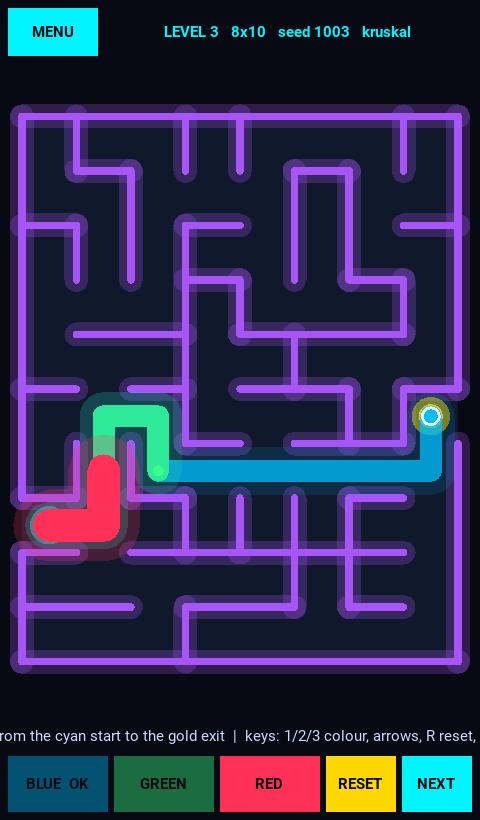
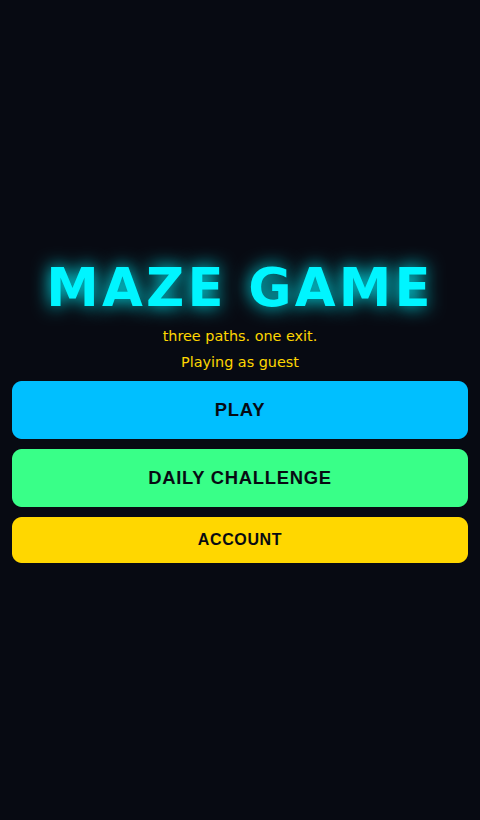
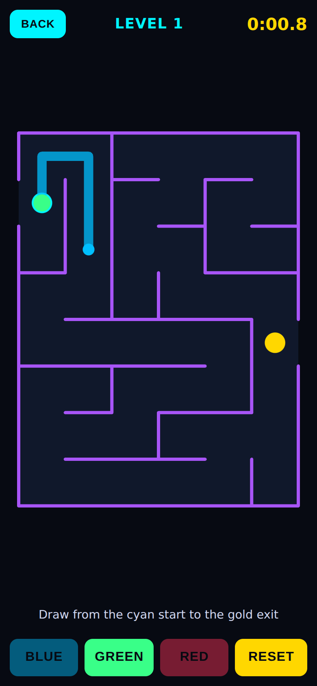
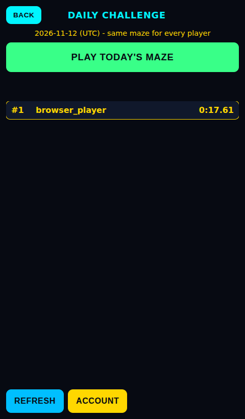
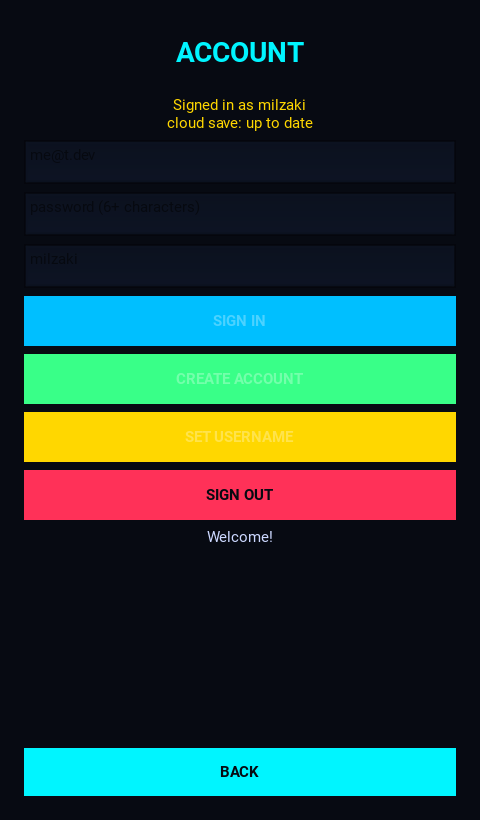
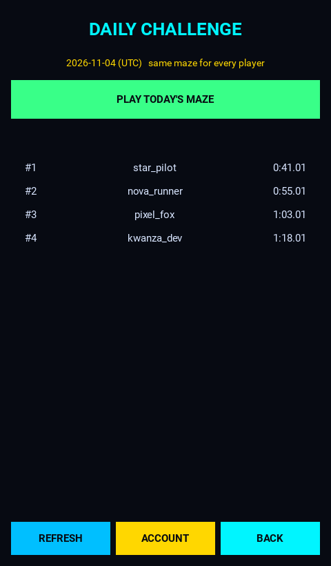
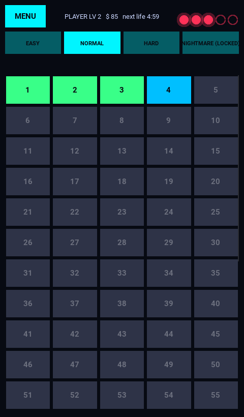
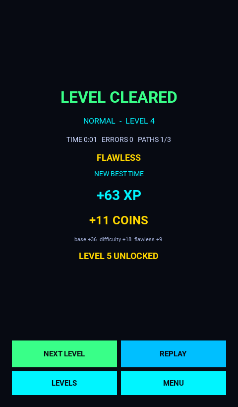
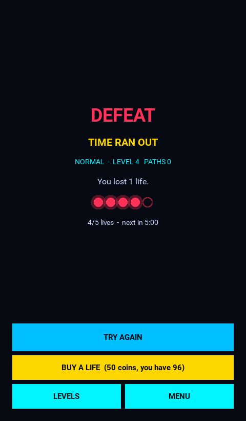

# MAZE GAME

Futuristic neon maze puzzle: draw **three independent paths** (blue, green, red) from the entrance to the exit
with a finger or mouse. Python 3 + Kivy (Android / Windows / Linux); a TypeScript/Phaser web client is planned.



## Run

```bash
python3 -m venv .venv && source .venv/bin/activate
pip install -r requirements.txt
python main.py              # needs a display
MAZE_LOW_FX=1 python main.py   # disable glow for low-end devices
```

Controls — mouse/touch: press near the head of the active path and drag. Keyboard: `1` `2` `3` choose colour,
arrow keys step, `R` reset the active path, `N` next level, `Esc` menu.

Headless (CI / Codespaces): `xvfb-run -a python main.py`.

## Test

```bash
KIVY_NO_ARGS=1 python -m pytest -q
```

## Progression system

Clear a level to earn **XP** and **coins**, unlock the next level, and climb your **player level**.

| Rule | Behaviour |
|---|---|
| **Victory** | Reach the exit with at least the required number of paths before time runs out (EASY/NORMAL 1, HARD 2, NIGHTMARE 3). Completing all three paths gives bonus XP and coins. |
| **Defeat** | The time limit expires. This is the *only* way to lose a life. |
| **Errors** | Hitting a wall or crossing your own path is counted (it removes the *flawless* bonus) but never costs a life — backtrack or reset freely. |
| **Leaving** | Leaving a level early is free: no life lost, no reward. |
| **Lives** | 5 max, +1 every 5 min (also while the game is closed), +1 on every player level-up, or buy one for 50 coins. With 0 lives you cannot start a level. |
| **Unlocking** | Only level 1 is open per difficulty. Clearing level *n* unlocks *n+1*; cleared levels can be replayed (replays pay 50%). NEXT / `N` only work when the next level is already unlocked. |
| **Difficulty** | EASY, NORMAL (the original curve), HARD, and **NIGHTMARE** (unlocked by clearing HARD level 10). Each has its own progress, maze size, algorithms, time limit and reward multiplier. |
| **Stats** | attempts, levels played (win or loss), levels completed (wins incl. replays), defeats, best level, XP, coins earned, play time, best time per level. |

All numbers are in `game/core/balance.py` and `game/progression/difficulty.py`.

### Save file

Progress is saved as JSON (`progress.json`, atomic write, schema-versioned) in Kivy's `user_data_dir`
(works on Android, Windows, Linux). Override the folder with `MAZE_SAVE_DIR`. A corrupt or tampered file is
moved to `progress.json.corrupt-<time>` and the game starts fresh instead of crashing; if saving fails the game
keeps running and shows a warning on the menu.

## Web version

Play in the browser (same accounts, daily challenge and leaderboard as Android). TypeScript + Vite + Canvas in
[`web/`](web/), deployable on Vercel: see [`docs/WEB.md`](docs/WEB.md).

| Menu | Mobile play | Daily leaderboard |
|---|---|---|
|  |  |  |

## Online: accounts, cloud save, daily challenge

Optional and local-first: the game never needs an account. Signing in adds **cloud save** (pushed in the
background, newest-XP-wins, never overwrites newer progress), a **daily challenge** (the same maze for everyone,
fastest valid time wins) and a **public leaderboard**. All judging is server-side (time, path, rate limits).
Setup guide: [`docs/ONLINE_SETUP.md`](docs/ONLINE_SETUP.md).

| Piece | Where |
|---|---|
| Database, RLS, server functions | `backend/migrations/0001_online.sql` |
| Auth, API, cloud sync, daily client | `game/online/` |
| Daily challenge definition + publisher | `game/progression/daily.py`, `tools/publish_daily.py` |
| Screens | `interface/screens/account.py`, `daily.py` |

Backend tests run the real migration on PostgreSQL: `pip install -r requirements-dev.txt`, then
`MAZE_TEST_PG_DSN="dbname=postgres user=postgres password=... host=localhost" pytest` (skipped if unreachable).

| Account | Daily leaderboard |
|---|---|
|  |  |

## Architecture

| Package | Responsibility | Kivy? |
|---|---|---|
| `game/maze` | `Maze`, seeded generators, BFS solver + hints | no |
| `game/paths` | `Path` rules, `PathManager` (three independent paths) | no |
| `game/input` | `PointerEvent`, `Viewport`, `DrawingController` | no |
| `game/progression` | `levels`, `difficulty`, `xp`, `rewards`, `unlocks`, `stats`, `session` (victory/defeat rules), `profile`, **`service` (the only API the UI uses)** | no |
| `game/lives`, `game/economy` | `Lives` (time-based regeneration), `Wallet` (earn/spend ledger — shop-ready) | no |
| `game/persistence` | `ProfileRepository` contract, `JsonProfileRepository`, `MemoryRepository` | no |
| `game/online` | Supabase auth, RPC client with token refresh, local-first cloud save, daily challenge client | no |
| `backend/` | PostgreSQL migration (tables, RLS, validating functions) | - |
| `interface/` | screens (splash, menu, level select, gameplay, victory, defeat, account, daily), HUD components, effects, neon theme | yes |

Progress lives in `ProgressService`, never in widgets. A future `SupabaseRepository` only needs
`load()`, `save()` and `discard_corrupt()` (see `game/persistence/repository.py`).

## Screenshots

| Level select | Gameplay HUD | Victory | Defeat |
|---|---|---|---|
|  |  |  |  |

## Known limitations

* Time and lives of the normal levels use the device clock (a player can cheat by changing it); only the daily challenge is judged by the server. XP/coins are not yet server-authoritative.
* The online layer was tested against a real PostgreSQL behind a simulated Supabase HTTP API, **not** against a live Supabase project, and the GitHub workflows have not been executed.
* Timer keeps running if the app is sent to the background.
* No sound yet; no achievements, daily challenges or special obstacles — the "challenge" and "achievement" coin sources are not implemented.
* Balance values are first estimates and have not been playtested.
* Not yet verified on a real Android device or touchscreen.
